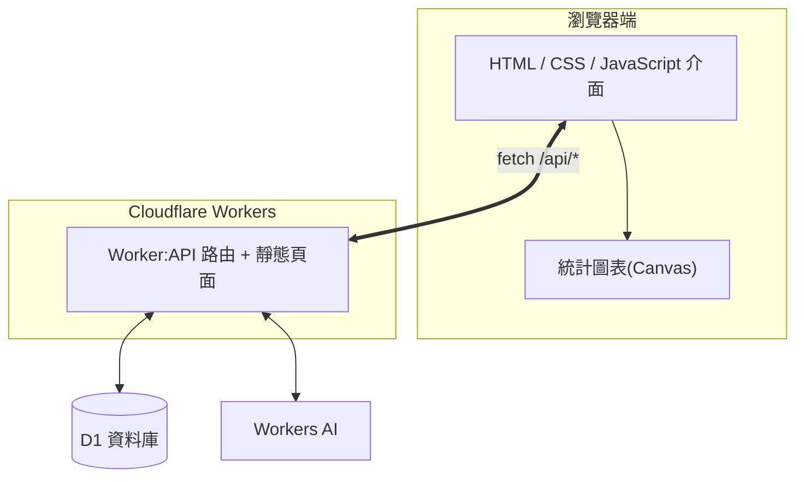

# StudyBox · AI 讀書助手

> 把筆記貼進來,AI 幫你整理重點、出題考你、做成閃卡,再用圖表告訴你哪裡最需要複習。
>
> 全端網站,以 Cloudflare Workers 部署,搭配 D1 資料庫與 Workers AI。

網址：<https://studybox.se08-111410555.workers.dev>

---

## 📖 1. 專案背景與解決痛點

期末考前要讀的內容很多,但實際讀書時常遇到這些問題:

1. **整理筆記很花時間**:把課堂內容濃縮成重點,有時比讀書本身還累。
2. **不知道自己哪裡不熟**:讀完一遍覺得都懂,考試才發現盲點。
3. **複習方式單調**:只是反覆重讀,效率低又容易分心。

**StudyBox 的解法:** 把「整理 → 自測 → 複習 → 檢討」整合在同一個網站。使用者只要貼上筆記,其餘的摘要、題目、閃卡都交給 AI 產生,並記錄每次作答結果,用統計圖表找出薄弱科目。

## ✨ 2. 核心功能亮點

- **📝 筆記庫**:新增、編輯、刪除筆記,依科目分類、關鍵字搜尋、釘選重要內容。
- **🤖 AI 摘要**:一鍵把長篇筆記濃縮成重點整理,並抽出關鍵字。
- **❓ AI 自動出題**:根據筆記產生選擇題,附正確答案與解析。
- **✅ 作答與批改**:選擇答案後立即批改,並記錄每次作答結果。
- **🃏 閃卡複習**:把重點做成翻面卡片,標記「記得 / 不記得」。
- **📊 學習統計**:以圖表呈現答對率、複習次數與各科目弱點。
- **💾 資料持久化**:所有資料存在 Cloudflare D1,重新整理或換裝置都還在。

## 🏗️ 3. 系統架構

### 架構圖



### 資料流程(以「AI 出題」為例)

1. 使用者在筆記詳情頁按下「AI 出題」(或在「測驗複習」頁按「AI 出題」)。
2. 前端呼叫 `POST /api/notes/:id/questions`。
3. Worker 從 D1 讀出筆記內容,組成提示詞,呼叫 Workers AI。
4. 檢查 AI 回傳的格式是否正確(題目、四個選項、答案索引)。
5. 格式正確才寫入 D1,並回傳給前端顯示。

### 技術選型與理由

| 層級 | 技術 | 選用理由 |
| :--- | :--- | :--- |
| 前端 | HTML + CSS + JavaScript | 不需打包工具,結構簡單,適合單人快速開發。 |
| 後端 | Cloudflare Workers | 沒有伺服器要維護,API 與靜態頁面由同一個 Worker 提供。 |
| 資料庫 | Cloudflare D1(SQLite) | 與 Workers 原生整合,關聯式資料適合存筆記、題目、紀錄。 |
| AI | Workers AI | 與 Worker 在同一平台,不需另外申請與管理 API 金鑰。 |
| 部署 | Wrangler | 一行指令即可部署,與課堂教的流程一致。 |

## 📦 4. 資料格式

### 筆記(`notes`)

| 欄位 | 型別 | 說明 |
| --- | --- | --- |
| `id` | integer | 主鍵 |
| `subject` | text | 科目 |
| `title` | text | 標題 |
| `content` | text | 筆記內容 |
| `summary` | text | AI 摘要(可為空) |
| `keywords` | text | AI 關鍵字;資料庫存 JSON 字串,API 回傳時轉為陣列 |
| `pinned` | integer | 是否釘選(0 / 1) |
| `created_at` | text | 建立時間 |

### 題目(`questions`)

| 欄位 | 型別 | 說明 |
| --- | --- | --- |
| `id` | integer | 主鍵 |
| `note_id` | integer | 所屬筆記 |
| `question` | text | 題目 |
| `options` | text | 四個選項;資料庫存 JSON 字串,API 回傳時轉為陣列 |
| `answer` | integer | 正確選項索引(0–3) |
| `explanation` | text | 解析 |

### 答題紀錄(`attempts`)與閃卡(`cards`)

| 資料表 | 主要欄位 |
| --- | --- |
| `attempts` | `id`、`question_id`、`is_correct`、`created_at` |
| `cards` | `id`、`note_id`、`front`、`back`、`remembered`、`forgotten` |

> `pinned`、`is_correct` 在資料庫中以 `0 / 1` 儲存。題目在作答前,API 不會回傳 `answer` 與 `explanation`,避免提前看到解答。

完整建表語法請見 `schema.sql`。

## 🔌 5. API 規格

| 方法 | 路徑 | 說明 |
| --- | --- | --- |
| `GET` | `/api/health` | 健康檢查 |
| `GET` | `/api/notes` | 筆記列表,支援 `?q=` 搜尋、`?subject=` 篩選 |
| `GET` | `/api/notes/:id` | 取得單篇筆記(含題目與閃卡) |
| `POST` | `/api/notes` | 新增筆記 |
| `PUT` | `/api/notes/:id` | 修改筆記(含釘選) |
| `DELETE` | `/api/notes/:id` | 刪除筆記 |
| `POST` | `/api/notes/:id/summarize` | AI 產生摘要與關鍵字 |
| `POST` | `/api/notes/:id/questions` | AI 產生題目 |
| `POST` | `/api/notes/:id/cards` | AI 產生閃卡 |
| `POST` | `/api/questions/:id/answer` | 送出答案並記錄結果 |
| `POST` | `/api/cards/:id/review` | 記錄「記得 / 不記得」 |
| `GET` | `/api/stats` | 學習統計資料 |

### 主要請求欄位

| 路徑 | 方法 | 請求本體 |
| --- | --- | --- |
| `/api/notes` | `POST` | `{ "subject": "生物", "title": "細胞呼吸", "content": "..." }` |
| `/api/notes/:id` | `PUT` | 可只包含要更新的欄位:`subject`、`title`、`content`、`pinned`(`0 / 1` 或 `true / false`) |
| `/api/questions/:id/answer` | `POST` | `{ "answer": 2 }`(`0–3`,也可傳字串 `"2"`) |
| `/api/cards/:id/review` | `POST` | `{ "remembered": true }` |

> `summarize`、`questions`、`cards` 三個 AI 端點不需要請求本體,只要路徑中的筆記 `id`。
> `GET /api/notes/:id` 會回傳筆記,加上 `questions`(**不含**答案與解析)與 `cards`,供前端重新整理後還原詳情。

### 統計回傳結構(`GET /api/stats`)

```json
{
  "ok": true,
  "data": {
    "totals": {
      "notes": 3,
      "questions": 6,
      "cards": 10,
      "attempts": 12,
      "correct": 8,
      "accuracy": 67,
      "remembered": 4,
      "forgotten": 2,
      "reviews": 6
    },
    "subjects": [
      { "subject": "生物", "attempts": 12, "correct": 8, "accuracy": 67, "note_count": 1 }
    ],
    "daily": [
      { "date": "2026-11-20", "label": "11/20", "attempts": 3, "correct": 2, "accuracy": 67 }
    ],
    "recent": [
      {
        "id": 1,
        "is_correct": 1,
        "created_at": "2026-11-20T04:00:00.000Z",
        "question": "...",
        "note_title": "...",
        "subject": "生物"
      }
    ],
    "generated_at": "2026-11-20T04:00:00.000Z"
  }
}
```

> `daily` 固定回傳最近 7 天(以 `Asia/Taipei` 計算),沒有作答的日子補 0;`subjects` 只列出有作答紀錄的科目。

成功回應:

```json
{ "ok": true, "data": { } }
```

失敗回應:

```json
{ "ok": false, "error": "AI_INVALID_OUTPUT", "message": "AI 回傳的格式不正確,請重試" }
```

常見 `error` 代碼:`VALIDATION_ERROR`(欄位錯誤)、`INVALID_JSON`、`PAYLOAD_TOO_LARGE`、`NOT_FOUND`、`METHOD_NOT_ALLOWED`、`AI_UNAVAILABLE`、`AI_INVALID_OUTPUT`、`AI_TIMEOUT`、`INTERNAL_ERROR`。

## 📂 6. 專案目錄結構

```text
studybox/
├── wrangler.toml          # Workers 設定:D1、AI 綁定、靜態資源目錄
├── package.json           # dev / deploy / db 指令
├── package-lock.json      # 套件版本鎖定
├── .gitignore             # 忽略 node_modules、.wrangler 等本機檔案
├── schema.sql             # 資料表定義
├── src/
│   ├── index.js           # Worker 入口:API 路由 + 靜態資源
│   ├── ai.js              # Workers AI 呼叫與回傳格式檢查
│   └── db.js              # D1 資料存取函式
├── public/
│   ├── index.html         # 主頁面(筆記庫)
│   ├── study.html         # 出題與閃卡複習頁
│   ├── stats.html         # 學習統計頁
│   ├── style.css          # 樣式與響應式版面
│   └── app.js             # 前端邏輯:呼叫 API、畫面更新、圖表
└── README.md
```

## 🚀 7. 快速開始

### 環境需求

- Node.js 18 以上
- Cloudflare 帳號(免費方案即可)

### 本機開發

```bash
# 若已取得專案資料夾,直接 cd 進入即可,不需要 clone
git clone https://github.com/<帳號>/studybox.git
cd studybox
npm install

# Workers AI 連的是遠端服務,本機要測試 AI 功能也必須先登入
npx wrangler login

# 建立本機資料表並啟動
npx wrangler d1 execute studybox-db --local --file=./schema.sql
npx wrangler dev
```

也可以用 `npm run db:init` 代替建表指令、`npm run dev` 代替啟動指令。

開啟 http://localhost:8787 。

### 部署到 Cloudflare

```bash
npx wrangler login
npx wrangler d1 create studybox-db      # 將輸出的 database_id 填入 wrangler.toml
npx wrangler d1 execute studybox-db --remote --file=./schema.sql
npx wrangler deploy
```

> `wrangler.toml` 目前已填入真實 `database_id`。若你重新建立 D1 資料庫,請把 `npx wrangler d1 create studybox-db` 回傳的新 ID 貼回 `wrangler.toml`,並再次執行遠端 `schema.sql`。
> AI 模型預設為 `@cf/meta/llama-3.1-8b-instruct-fast`,若要更換可修改 `wrangler.toml` 的 `[vars] AI_MODEL`。

部署完成後,Wrangler 會印出 `*.workers.dev` 網址。

## 🧭 8. 使用方式

1. **開啟網站**,進入筆記庫。
2. **新增筆記**:輸入科目、標題與內容後儲存。
3. **產生摘要**:點開筆記,按「AI 摘要」,等待重點與關鍵字出現。
4. **產生題目**:按「AI 出題」,系統會產生數題選擇題。
5. **開始作答**:選擇答案,送出後立即顯示對錯與解析。
6. **閃卡複習**:進入閃卡頁,翻面查看答案並標記「記得 / 不記得」。
7. **查看統計**:進入統計頁,從圖表找出答對率低的科目,針對性複習。
8. **管理筆記**:可釘選重要筆記、搜尋、依科目篩選,或刪除不需要的內容。

## 🧪 9. 功能測試

測試環境:本機 `wrangler dev` + 本機 D1 + 實際 Workers AI;以 Chrome 模擬 1440 / 768 / 390 三種寬度。測試日期:2026-11-20。

| 測試項目 | 測試結果 |
| --- | --- |
| 新增 / 編輯 / 刪除筆記 | ✅ 通過 |
| 搜尋與科目篩選 | ✅ 通過(含找不到結果的空狀態) |
| 釘選筆記 | ✅ 通過(重新整理後仍排在筆記庫最前面) |
| AI 摘要 | ✅ 通過(實際呼叫 Workers AI,產出繁體中文重點與關鍵字) |
| AI 出題 | ✅ 通過(3 題,每題 4 個選項與解析) |
| 作答與批改 | ✅ 通過(答對 / 答錯皆記錄並顯示解析) |
| 閃卡翻面與標記 | ✅ 通過(5 張,「記得 / 不記得」皆寫入 D1) |
| 統計圖表數字正確 | ✅ 通過(近 7 天、科目正確率與作答數同步更新) |
| AI 失敗時的錯誤提示 | ✅ 通過(以無效模型觸發 502 / `AI_UNAVAILABLE`,畫面顯示錯誤提示,按鈕回復可用、對話框未中斷) |
| 手機版 / 平板 / 桌機版面 | ✅ 通過(390 / 768 / 1440 皆無水平捲動,彈窗與底部導覽正常) |

### 驗收檢查表

- [x] `GET /api/health` 回傳 `ok: true`
- [x] 重新整理頁面後,筆記與紀錄仍然保留(D1 持久化)
- [x] AI 產生的題目有 4 個選項,且有正確答案
- [x] 答錯題目後,統計頁的答對率會同步更新
- [x] AI 失敗時,畫面顯示錯誤提示而不是當掉
- [x] 1440 / 768 / 390 三種寬度沒有水平捲動

## ⚠️ 10. 目前限制

- 沒有使用者登入,所有資料屬於同一個使用者。
- AI 產生的題目可能有錯誤或不夠精確,仍需自行判斷。
- 單篇筆記最多 20,000 字;送給 AI 時會節錄前 6,500 字,避免超過模型輸入限制。
- 即使使用 `wrangler dev`,Workers AI 仍會呼叫遠端服務,需先 `npx wrangler login`,且可能產生用量。
- 免費方案的 D1 與 Workers AI 有每日用量上限。

## 🔮 11. 未來改進方向

- 加入使用者登入,支援多人使用。
- 依遺忘曲線安排複習時間(間隔重複)。
- 支援上傳 PDF 或圖片筆記。
- 匯出摘要與題目為 PDF。
- 深色模式。

## 📝 12. 專案成果與心得

完成筆記 CRUD、科目分類與搜尋、AI 摘要/出題/閃卡、作答批改與學習統計,並確保資料保存在 D1、三個頁面在手機與桌機都能正常使用。

遇到比較棘手的問題是 AI 回傳格式不穩定、作答前不能洩漏答案,以及手機版對話框與底部導覽的顯示時機。透過格式驗證、API 層過濾欄位與實際瀏覽器測試逐一解決,也學到 Workers、D1、Workers AI 與靜態資源整合的完整流程,以及部署前必須先建立遠端資料庫並填入真實 `database_id`。